# Elastic5G: A Rebuildable Kubernetes Testbed for Dynamic Network Slicing and NWDAF-Driven 5G Core Research

## Overview

<div align="center">
    
</div>


This repository provides a practical environment for experimenting with the **OpenAirInterface (OAI) 5G Standalone Core** on Kubernetes.

OpenAirInterface offers valuable open-source 5G solutions for the research and engineering community. Our goal is to bring these components together in a single repository and make their deployment easier, more consistent, and more reproducible.

By centralizing deployment assets, build workflows, and configuration files, this repository aims to simplify the setup of OAI-based 5G core environments for experimentation, development, and research.

The main objective is not only to deploy the core network, but also to **build, modify, and rebuild the different 5G Core Network Functions (NFs)** for research and development purposes. This is especially useful when testing new features, debugging specific behaviors, or evaluating protocol and architectural changes in the 5G core.

In this tutorial, we focus on how to:
- build the different **OAI 5G Core NFs** from source,
- adapt Docker images after code modifications,
- redeploy the updated functions in a Kubernetes-based testbed,
- run reproducible experiments for research on the 5G core.

The platform is based on a modular, open-source architecture and can integrate:
- **OAI 5G SA Core**
- **UERANSIM** for gNB/UE simulation
- disaggregated RAN components when needed
- monitoring tools such as **Prometheus** and **Grafana**

This setup is suitable for experimentation on:
- control plane procedures,
- user plane behavior,
- slicing and multi-slice deployments,
- NF interoperability,
- performance evaluation after source-code modifications.

For lightweight environments, a **k3s**-based variant can also be used.


## Table of Contents

- [Build a K8s cluster](#build-a-k8s-cluster)
- [Tools Setup](#tools-setup)
- [OAI 5G SA Core: Build and Deployment Guide](#oai-5g-sa-core-build-and-deployment-guide)
- [Build and Deploy NWDAF Components](#build-and-deploy-nwdaf-components)
- [Radio Access Network: OAI Disaggregated CU/DU](#radio-access-network-oai-disaggregated-cudu)
- [Alternative RAN deployments](docs/ran-alternatives.md)
- [Modify and rebuild the RAN images](docs/modify-ran-images.md)
- [eMBB Video Traffic Validation](#embb-video-traffic-validation-enhanced-mobile-broadband)
- [Network Slicing](#network-slicing)
- [Resource and Energy Monitoring with Prometheus, Kepler and Grafana](#resource-and-energy-monitoring-with-prometheus-kepler-and-grafana)
- [License and citation](#license-and-citation)

# Build a K8S cluster
We assume that a Kubernetes cluster is already running using this repository: https://github.com/AIDY-F2N/k8s-cluster-setup-ubuntu24.git

# Tools Setup

1.  Install the Helm CLI usnig this link: https://helm.sh/docs/intro/install/

Helm CLI (Command-Line Interface) is a command-line tool used for managing applications on Kubernetes clusters. It is part of the Helm package manager, which helps you package, deploy, and manage applications as reusable units called Helm charts.

Helm provides a straightforward way to define, install, and upgrade complex Kubernetes applications. With Helm, you can define the desired state of your application using a declarative YAML-based configuration file called a Helm chart. A Helm chart contains all the necessary Kubernetes manifests, configurations, and dependencies required to deploy and run your application.

2.  Install Helm Spray using this command: 
```bash[language=bash]
helm plugin install https://github.com/ThalesGroup/helm-spray
```
Helm Spray is a Helm plugin that simplifies the deployment of Kubernetes applications using Helm charts. Helm is a package manager for Kubernetes that allows you to define, install, and manage applications as reusable units called charts. Helm Spray extends Helm's functionality by providing additional features and capabilities for managing the lifecycle of complex deployments. The command helm plugin install installs the Helm Spray plugin, enabling you to use its functionalities alongside Helm.

3. Clone Multus GitHub repository:
```bash[language=bash]
git clone https://github.com/k8snetworkplumbingwg/multus-cni.git
```
  - Apply a daemonset which installs Multus using kubectl. From the root directory of the clone, apply the daemonset YAML file:
    ```bash[language=bash]
    kubectl apply -f multus-cni/deployments/multus-daemonset-thick.yml
    ```
  - Raise the resources of the Multus daemon. The manifest gives it 50 Mi of memory; when about twenty pods are created at once (`helm install 5gc` followed by the NWDAF) it is `OOMKilled`, then crash-loops, and every pod that needs a Multus interface stays in `ContainerCreating` for minutes (`failed to setup network for sandbox ... plugin type="multus"`):
    ```bash[language=bash]
    kubectl -n kube-system patch ds kube-multus-ds --type=json -p '[{"op":"replace","path":"/spec/template/spec/containers/0/resources","value":{"requests":{"cpu":"100m","memory":"100Mi"},"limits":{"cpu":"1","memory":"1Gi"}}}]'
    ```
4. Create oai5g namespace using the below command: 
    ```bash[language=bash]
    kubectl create ns oai5g
    ```

5. Clone or download this repository

6. Install Metrics Server:
To enable auto-scaling features like HPA (Horizontal Pod Autoscaler), deploy the Kubernetes metrics server (note: the autoscaling of the UPF is disabled with UPF-VPP, see [docs/CHANGES-upf-vpp.md](docs/CHANGES-upf-vpp.md)):
```bash[language=bash]
kubectl apply -f metricserver.yaml
```

# OAI 5G SA Core: Build and Deployment Guide

## Building OAI 5G Core Images

In this repository, we use **OpenAirInterface CN5G release `v2.2.1`** as the reference version for building the 5G Core Network Functions.

### 1. Clone the repository

```bash
git clone --branch v2.2.1 https://gitlab.eurecom.fr/oai/cn5g/oai-cn5g-fed.git
cd oai-cn5g-fed
git submodule sync --recursive
git submodule update --init --recursive
./scripts/syncComponents.sh --branch v2.2.1
````

### 2. Increase swap memory

Some network functions, especially during compilation, may require a significant amount of memory.
To avoid build failures caused by memory exhaustion, it is recommended to increase the swap space before building the images:

```bash
sudo fallocate -l 16G /swapfile && sudo chmod 600 /swapfile && sudo mkswap /swapfile && sudo swapon /swapfile
```

### 3. Build the OAI 5G Core images

Build each network function image as follows:

#### NRF

```bash
docker build --target oai-nrf --tag oai-nrf:v2.2.1 \
  --file oai-cn5g-fed/component/oai-nrf/docker/Dockerfile.nrf.ubuntu \
  --build-arg BASE_IMAGE=ubuntu:jammy \
  oai-cn5g-fed/component/oai-nrf
```

#### NSSF

```bash
docker build --target oai-nssf --tag oai-nssf:v2.2.1 \
  --file oai-cn5g-fed/component/oai-nssf/docker/Dockerfile.nssf.ubuntu \
  --build-arg BASE_IMAGE=ubuntu:jammy \
  oai-cn5g-fed/component/oai-nssf
```

#### LMF

```bash
docker build --target oai-lmf --tag oai-lmf:v2.2.1 \
  --file oai-cn5g-fed/component/oai-lmf/docker/Dockerfile.lmf.ubuntu \
  --build-arg BASE_IMAGE=ubuntu:jammy \
  oai-cn5g-fed/component/oai-lmf
```

#### UDR

```bash
docker build --target oai-udr --tag oai-udr:v2.2.1 \
  --file oai-cn5g-fed/component/oai-udr/docker/Dockerfile.udr.ubuntu \
  --build-arg BASE_IMAGE=ubuntu:jammy \
  oai-cn5g-fed/component/oai-udr
```

#### UDM

```bash
docker build --target oai-udm --tag oai-udm:v2.2.1 \
  --file oai-cn5g-fed/component/oai-udm/docker/Dockerfile.udm.ubuntu \
  --build-arg BASE_IMAGE=ubuntu:jammy \
  oai-cn5g-fed/component/oai-udm
```

#### AUSF

```bash
docker build --target oai-ausf --tag oai-ausf:v2.2.1 \
  --file oai-cn5g-fed/component/oai-ausf/docker/Dockerfile.ausf.ubuntu \
  --build-arg BASE_IMAGE=ubuntu:jammy \
  oai-cn5g-fed/component/oai-ausf
```

#### AMF

```bash
docker build --target oai-amf --tag oai-amf:v2.2.1 \
  --file oai-cn5g-fed/component/oai-amf/docker/Dockerfile.amf.ubuntu \
  --build-arg BASE_IMAGE=ubuntu:jammy \
  oai-cn5g-fed/component/oai-amf
```

#### UPF-VPP

The user plane function is **UPF-VPP** (`oai-upf-vpp`, the VPP-based OAI UPF). It is built from the `oai-cn5g-fed/component/oai-upf-vpp` component like the other network functions (VPP is compiled from source, this is the longest build of the list):

```bash
docker build --target oai-upf-vpp --tag oai-upf-vpp:v2.2.1 \
  --file oai-cn5g-fed/component/oai-upf-vpp/docker/Dockerfile.upf-vpp.ubuntu \
  --build-arg BASE_IMAGE=ubuntu:focal \
  oai-cn5g-fed/component/oai-upf-vpp
```

> Unlike the other network functions, UPF-VPP is built on `ubuntu:focal` (20.04): the VPP `stable/2101` sources it compiles need the `dh-systemd` package, which no longer exists on `ubuntu:jammy` (the build stops with `E: Unable to locate package dh-systemd`).

> UPF-VPP is configured only through environment variables (`vpp:` block of each UPF-VPP chart `values.yaml`) and needs a dedicated Multus interface for N3 and for N6. See [docs/CHANGES-upf-vpp.md](docs/CHANGES-upf-vpp.md) for the details and the host prerequisites.

#### SMF

```bash
docker build --target oai-smf --tag oai-smf:v2.2.1 \
  --file oai-cn5g-fed/component/oai-smf/docker/Dockerfile.smf.ubuntu \
  --build-arg BASE_IMAGE=ubuntu:jammy \
  oai-cn5g-fed/component/oai-smf
```
### 4. Verify the generated images

After the build, verify that all images are available locally:

```bash
docker images | grep oai
```

<div align="center">
    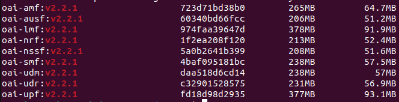
</div>

## Loading the images into the Kubernetes runtime

If your Kubernetes cluster uses `containerd`, the locally built Docker images must be exported and imported into the Kubernetes image runtime.

You can first verify the container runtime used by your node:

```bash
kubectl get node <node-name> -o jsonpath='{.status.nodeInfo.containerRuntimeVersion}{"\n"}'
```

Then load each image into `containerd`:

```bash
docker save oai-nrf:v2.2.1 -o /tmp/oai-nrf.tar
sudo ctr -n k8s.io images import /tmp/oai-nrf.tar

docker save oai-nssf:v2.2.1 -o /tmp/oai-nssf.tar
sudo ctr -n k8s.io images import /tmp/oai-nssf.tar

docker save oai-lmf:v2.2.1 -o /tmp/oai-lmf.tar
sudo ctr -n k8s.io images import /tmp/oai-lmf.tar

docker save oai-udr:v2.2.1 -o /tmp/oai-udr.tar
sudo ctr -n k8s.io images import /tmp/oai-udr.tar

docker save oai-udm:v2.2.1 -o /tmp/oai-udm.tar
sudo ctr -n k8s.io images import /tmp/oai-udm.tar

docker save oai-ausf:v2.2.1 -o /tmp/oai-ausf.tar
sudo ctr -n k8s.io images import /tmp/oai-ausf.tar

docker save oai-amf:v2.2.1 -o /tmp/oai-amf.tar
sudo ctr -n k8s.io images import /tmp/oai-amf.tar

docker save oai-upf-vpp:v2.2.1 -o /tmp/oai-upf-vpp.tar
sudo ctr -n k8s.io images import /tmp/oai-upf-vpp.tar

docker save oai-smf:v2.2.1 -o /tmp/oai-smf.tar
sudo ctr -n k8s.io images import /tmp/oai-smf.tar
```

## UPF-VPP host prerequisites

UPF-VPP does not route through the kernel IP stack: it takes over its N3 and N6 interfaces directly. Each UPF-VPP pod is therefore attached, through Multus, to two Linux bridges of the node (`br-n3` for GTP-U towards the gNB, `br-n6` towards the data network), and the UERANSIM gNB is attached to `br-n3` as well.

1. Create the bridges, the N6 gateway, the return routes towards the UE pools (`12.1.1.0/24` ... `12.1.4.0/24`) and the NAT on **every node**, once per cluster (it re-applies itself after a reboot):

```bash
kubectl apply -f oai-5g-core/host-net-setup/daemonset.yaml
kubectl get pods -n host-net-setup -o wide   # one Running pod per node
```

2. The gNB and all UPF-VPP pods must run on the **same node** (L2 adjacency on `br-n3` / `br-n6`). Label that node:

```bash
kubectl label node <node-name> elastic5g.io/radio-plane=true
```

Without this label the UPF-VPP and gNB pods stay `Pending` (they do not start silently on the wrong node).

## Deployment

Once all images are built and loaded into the Kubernetes runtime, deploy the OAI 5G Core with Helm:

```bash
helm dependency update oai-5g-core/oai-5g-advance/
helm install 5gc oai-5g-core/oai-5g-advance/ -n oai5g
```

These commands update chart dependencies and deploy the full OAI 5G SA Core into your cluster.

To confirm the deployment status of the core components:
```bash[language=bash]
kubectl get pods -n oai5g 
```

<div align="center">
    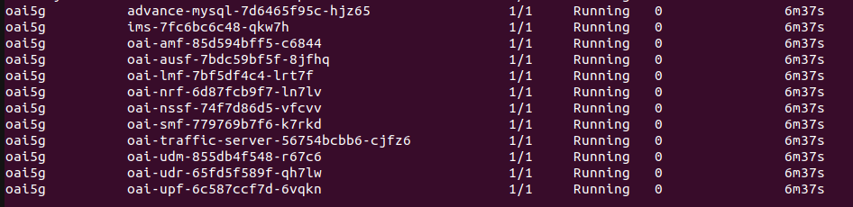
</div>

### Pod Command Reference

For debugging, inspection and operational verification, a set of useful commands for interacting with the different deployment pods is documented separately. See the full pod command guide here:  
**[Pod Commands Guide](docs/pod-commands.md)**


# Build and Deploy NWDAF Components

The **NWDAF** (**Network Data Analytics Function**) is a 5G Core function that provides analytics services to other network functions. It can be used to support automation, optimization, and data-driven decision-making in the core network.

The `NWDAF/` directory contains:
- a `components/` folder, which includes the required and tested files to **build** the NWDAF images,
- a `deployment/` folder, which contains the Kubernetes manifests used to **deploy** the NWDAF components.

The files available in `components/` were tested and updated on **April 20, 2026**.
If you want to use the latest upstream version, please refer to the official OAI NWDAF repository:

`https://gitlab.eurecom.fr/oai/cn5g/oai-cn5g-nwdaf`

## Build NWDAF images

```bash
docker build \
  --target oai-nwdaf-nbi-analytics --tag oai-nwdaf-nbi-analytics:latest \
  --file NWDAF/components/oai-nwdaf-nbi-analytics/docker/Dockerfile.nbi-analytics \
  NWDAF/components/oai-nwdaf-nbi-analytics

docker build \
  --target oai-nwdaf-nbi-events --tag oai-nwdaf-nbi-events:latest \
  --file NWDAF/components/oai-nwdaf-nbi-events/docker/Dockerfile.nbi-events \
  NWDAF/components/oai-nwdaf-nbi-events

docker build \
  --target oai-nwdaf-nbi-ml --tag oai-nwdaf-nbi-ml:latest \
  --file NWDAF/components/oai-nwdaf-nbi-ml/docker/Dockerfile.nbi-ml \
  NWDAF/components/oai-nwdaf-nbi-ml

docker build \
  --target oai-nwdaf-engine --tag oai-nwdaf-engine:latest \
  --file NWDAF/components/oai-nwdaf-engine/docker/Dockerfile.engine \
  NWDAF/components/oai-nwdaf-engine

docker build \
  --target oai-nwdaf-engine-ads --tag oai-nwdaf-engine-ads:latest \
  --file NWDAF/components/oai-nwdaf-engine-ads/docker/Dockerfile.engine-ads \
  NWDAF/components/oai-nwdaf-engine-ads

docker build \
  --target oai-nwdaf-sbi --tag oai-nwdaf-sbi:latest \
  --file NWDAF/components/oai-nwdaf-sbi/docker/Dockerfile.sbi \
  NWDAF/components/oai-nwdaf-sbi
```

## Verify the generated images

After the build, verify that all images are available locally:

```bash
docker images | grep nwdaf
```

<div align="center">
    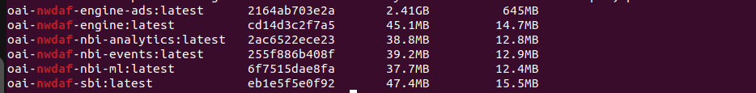
</div>

## Load NWDAF images into Kubernetes

```bash
docker save oai-nwdaf-engine-ads:latest -o /tmp/oai-nwdaf-engine-ads.tar
sudo ctr -n k8s.io images import /tmp/oai-nwdaf-engine-ads.tar

docker save oai-nwdaf-engine:latest -o /tmp/oai-nwdaf-engine.tar
sudo ctr -n k8s.io images import /tmp/oai-nwdaf-engine.tar

docker save oai-nwdaf-nbi-analytics:latest -o /tmp/oai-nwdaf-nbi-analytics.tar
sudo ctr -n k8s.io images import /tmp/oai-nwdaf-nbi-analytics.tar

docker save oai-nwdaf-nbi-events:latest -o /tmp/oai-nwdaf-nbi-events.tar
sudo ctr -n k8s.io images import /tmp/oai-nwdaf-nbi-events.tar

docker save oai-nwdaf-nbi-ml:latest -o /tmp/oai-nwdaf-nbi-ml.tar
sudo ctr -n k8s.io images import /tmp/oai-nwdaf-nbi-ml.tar

docker save oai-nwdaf-sbi:latest -o /tmp/oai-nwdaf-sbi.tar
sudo ctr -n k8s.io images import /tmp/oai-nwdaf-sbi.tar
```

## Deploy NWDAF components

Once the images are built and loaded, deploy the NWDAF-related pods using the manifests available in the `deployment/` folder:

```bash
kubectl apply -f NWDAF/deployment
```

To confirm the deployment status of the NWDAF components:

```bash
kubectl get pods -n oai5g
```
<div align="center">
    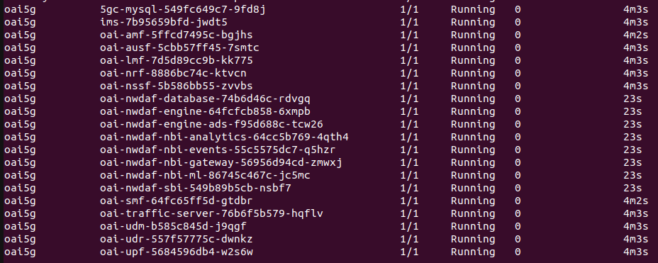
</div>

## Validate NWDAF

Once the core, a gNB and at least one UE are running, check that NWDAF receives the AMF and SMF events and answers its APIs:

```bash
NWDAF/scripts/check-nwdaf.sh
```

The script checks the pods, the MongoDB collections per slice, the engine API and the 3GPP analytics API through the gateway. The detailed procedure (per-slice queries, engine and gateway API calls, troubleshooting) is in [NWDAF slicing validation](docs/NWDAF-slicing-validation.md).


# Radio Access Network: OAI Disaggregated CU/DU

The OAI disaggregated 5G RAN follows a split gNB architecture where the gNB functions are separated into multiple logical components. Instead of running the whole gNB as a single monolithic process, the RAN is divided into a **Central Unit Control Plane (CU-CP)**, a **Central Unit User Plane (CU-UP)**, and a **Distributed Unit (DU)**.

In this architecture, the **CU-CP** handles control-plane functions such as RRC signaling and mobility-related procedures. The **CU-UP** handles user-plane traffic and forwards user data between the RAN and the 5G Core through the user-plane path. The **DU** is responsible for lower-layer radio functions and connects to the CU components through standardized split interfaces. This separation makes the RAN more modular and closer to real operator deployments, where control-plane and user-plane functions can be scaled, deployed, and tested independently.

In this repository, the disaggregated RAN is deployed with three Helm charts: one for the CU-CP, one for the CU-UP, and one for the DU. An **OAI NR-UE** is then deployed to attach to the network and generate traffic through the 5G user-plane tunnel.

- **CU-CP**: Central Unit - Control Plane
- **CU-UP**: Central Unit - User Plane
- **DU**: Distributed Unit
- **OAI NR-UE**: 5G User Equipment

> Other RAN deployment options, including the monolithic OAI RAN and UERANSIM, are documented in [Alternative Radio Access Network Deployments](docs/ran-alternatives.md).


## Build OAI Docker images
> This setup was tested with the OpenAirInterface `2025.w18` branch. More recent OAI branches can also be tested, but the Dockerfiles, image tags, or Helm chart values may need to be adapted accordingly.

Clone the OpenAirInterface repository using the `2025.w18` branch:

```bash
git clone --branch 2025.w18 https://gitlab.eurecom.fr/oai/openairinterface5g.git
```

> For details about which Dockerfiles and source files must be modified when changing the RAN behavior or rebuilding custom images, see [Modify and rebuild the RAN images](docs/modify-ran-images.md).


Build the required base image:

```bash
docker build \
  --target ran-base \
  --tag ran-base:latest \
  --file openairinterface5g/docker/Dockerfile.base.ubuntu22 \
  openairinterface5g
```

Build the RAN build image:

```bash
docker build \
  --target ran-build \
  --tag ran-build:latest \
  --file openairinterface5g/docker/Dockerfile.build.ubuntu22 \
  openairinterface5g
```

Build the gNB image:

```bash
docker build \
  --target oai-gnb \
  --tag oai-gnb:2025.w18 \
  --file openairinterface5g/docker/Dockerfile.gNB.ubuntu22 \
  openairinterface5g
```

Build the CU-UP image:

```bash
docker build \
  --target oai-nr-cuup \
  --tag oai-nr-cuup:2025.w18 \
  --file openairinterface5g/docker/Dockerfile.nr-cuup.ubuntu22 \
  openairinterface5g
```

Build the NR-UE image:

```bash
sed -i '/iperf \\/a\        curl \\\n        wget \\' openairinterface5g/docker/Dockerfile.nrUE.ubuntu22

docker build \
  --target oai-nr-ue \
  --tag oai-nr-ue:2025.w18 \
  --file openairinterface5g/docker/Dockerfile.nrUE.ubuntu22 \
  openairinterface5g
```

Import the generated images into the Kubernetes container runtime:

```bash
docker save oai-gnb:2025.w18 -o /tmp/oai-gnb.tar
sudo ctr -n k8s.io images import /tmp/oai-gnb.tar

docker save oai-nr-cuup:2025.w18 -o /tmp/oai-nr-cuup.tar
sudo ctr -n k8s.io images import /tmp/oai-nr-cuup.tar

docker save oai-nr-ue:2025.w18 -o /tmp/oai-nr-ue.tar
sudo ctr -n k8s.io images import /tmp/oai-nr-ue.tar
```

Verify that the images are available in containerd:

```bash
sudo ctr -n k8s.io images list | grep -E 'oai-gnb|oai-nr-cuup|oai-nr-ue'
```

## OAI Disaggregated 5G RAN

Deploy the components **one at a time**, waiting a few seconds between each step to ensure proper initialization.

### Deploy the RAN components

```bash
helm install cucp oai-5g-ran/dis_ran_gnb2/oai-cu-cp/ -n oai5g
helm install cuup oai-5g-ran/dis_ran_gnb2/oai-cu-up -n oai5g
helm install du oai-5g-ran/dis_ran_gnb2/oai-du -n oai5g
```

### Deploy the NR-UE

```bash
helm install nrue1 oai-5g-ran/oai-nr-ue2 -n oai5g
```

### Test connectivity

To confirm successful Internet access from the UE:

```bash
kubectl exec -it -n oai5g -c nr-ue $(kubectl get pods -n oai5g | grep oai-nr-ue2 | awk '{print $1}') -- ping -I oaitun_ue1 -c4 google.fr
```

<div align="center">
    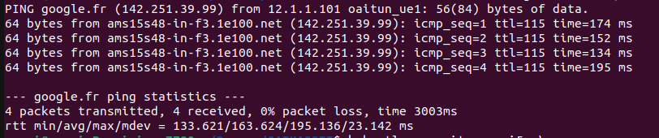
</div>


# eMBB Video Traffic Validation (Enhanced Mobile Broadband)

This section evaluates the capability of the eMBB slice to support high-bandwidth application traffic by simulating a real-world HD/4K video streaming scenario. Real video playback can be performed using VLC, while ensuring that all traffic explicitly traverses the 5G user plane through the OAI NR-UE tunnel interface.

The experiment validates:

* Sustained high-throughput delivery
* QoS enforcement via rate limitation
* UPF-VPP traffic monitoring using Grafana

---

## Architecture Overview

### Content Server

A Kubernetes pod running **NGINX** hosts the video file (`movie.mp4`).

* Namespace: `oai5g`
* Protocol: HTTP progressive download
* File size: real HD video ~600 MB

The server is deployed using:

```bash
kubectl apply -f Serveur_Video.yaml
```

Due to GitHub file size limitations, the test video used for eMBB validation is not included in this repository.

To reproduce the experiment, please download the sample video from Pexels:

🔗 [https://www.pexels.com/video/aerial-view-of-melbourne-s-scenic-skyline-30381543/](https://www.pexels.com/video/aerial-view-of-melbourne-s-scenic-skyline-30381543/)

### Steps

1. Download the video from the link above.
2. Rename the file to:

```bash
test_video.mp4
```

3. Place it in the root directory of the project.
4. Copy it into the Kubernetes video server pod:

```bash
kubectl cp test_video.mp4 oai5g/video-server:/usr/share/nginx/html/movie.mp4
```

---

### User Equipment

The UE is emulated using **OAI NR-UE**, deployed with the `oai-nr-ue2` Helm chart.

Traffic is explicitly forced through the OAI NR-UE tunnel interface:

```bash
oaitun_ue1
```

This guarantees that all video traffic:

* Traverses the UPF-VPP
* Is visible in Grafana monitoring
* Is subject to slice QoS policies

---

# Scenario A — Regulated Streaming Flow (QoS Enforcement)

In this scenario, the application throughput is intentionally limited to simulate QoS enforcement.

### Target Rate

```bash
2 MB/s ≈ 16 Mbps
```

`2M` in `curl` means **2 Megabytes/s**, not Megabits/s.

---

### Execute from the OAI NR-UE

The following command enforces an application-layer throughput limit of 2 MB/s while ensuring that traffic is routed through the 5G interface `oaitun_ue1`.

```bash
kubectl exec -it -n oai5g -c nr-ue \
$(kubectl get pods -n oai5g | grep oai-nr-ue2 | awk '{print $1}') \
-- curl --interface oaitun_ue1 \
http://$(kubectl get pod video-server -n oai5g -o jsonpath='{.status.podIP}')/movie.mp4 \
-o /dev/null \
--limit-rate 2M
```

<div align="center">
    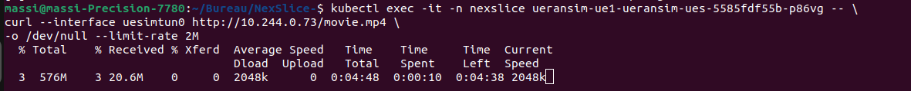
</div>

Optional: to validate the streaming behaviour with actual media playback, VLC can be used on the host machine. Make sure VLC is installed on the system executing the command.

```bash
kubectl exec -i -n oai5g -c nr-ue \
$(kubectl get pods -n oai5g | grep oai-nr-ue2 | awk '{print $1}') \
-- curl --interface oaitun_ue1 --limit-rate 2M -s \
http://$(kubectl get pod video-server -n oai5g -o jsonpath='{.status.podIP}')/movie.mp4 | vlc -
```

### Observations

* **UE Side:** Stable throughput around the configured limit.
* **Grafana:** Clear increase in UPF-VPP traffic.

<div align="center">
    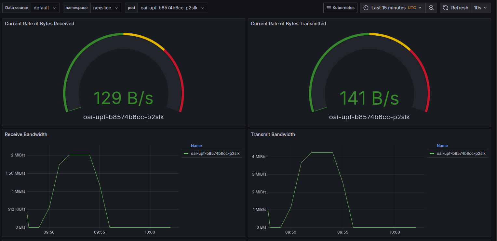
</div>

---

# Scenario B — Maximum Capacity Test (No Rate Limiting)

The rate limitation is removed to evaluate maximum slice throughput.

### Execute from the OAI NR-UE

```bash
kubectl exec -it -n oai5g -c nr-ue \
$(kubectl get pods -n oai5g | grep oai-nr-ue2 | awk '{print $1}') \
-- curl --interface oaitun_ue1 \
http://$(kubectl get pod video-server -n oai5g -o jsonpath='{.status.podIP}')/movie.mp4 \
-o /dev/null
```

<div align="center">
    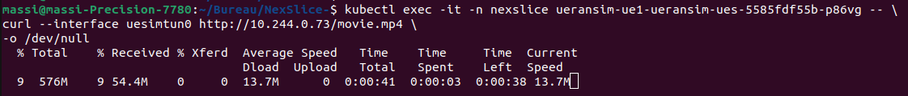
</div>

Optional: to validate the streaming behaviour with actual media playback, VLC can be used on the host machine.

```bash
kubectl exec -i -n oai5g -c nr-ue \
$(kubectl get pods -n oai5g | grep oai-nr-ue2 | awk '{print $1}') \
-- curl --interface oaitun_ue1 -s \
http://$(kubectl get pod video-server -n oai5g -o jsonpath='{.status.podIP}')/movie.mp4 | vlc -
```

### Observations

* **UE Download Speed:** maximum throughput depends on the current RAN, UPF-VPP, and host resources.
* **Grafana:** significant traffic spike should be observed on the UPF-VPP.

<div align="center">
    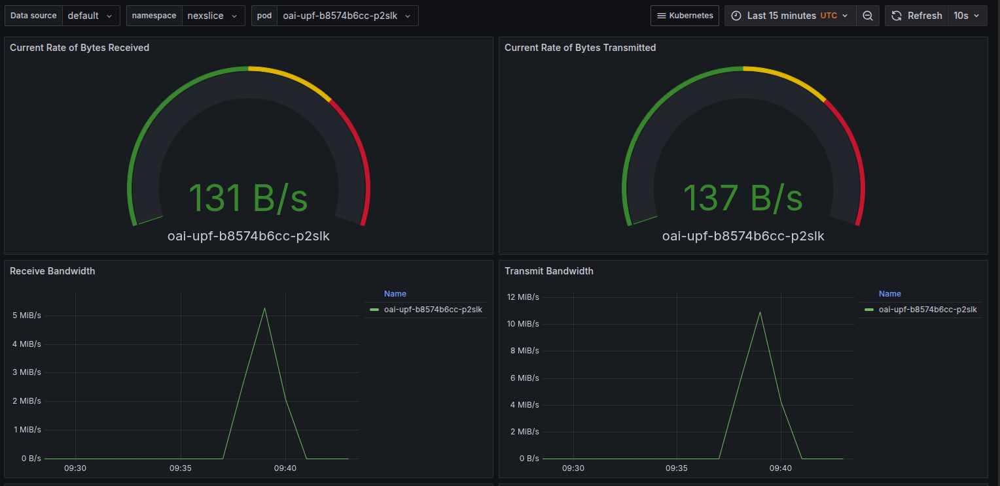
</div>

# Network Slicing

The objective of this part is to attach multiple network slices to the same 5G core network.

In this architecture, the main core network is deployed once and shared by all slices.  
Then, additional slices can be added progressively by deploying slice-specific components such as dedicated SMF and UPF-VPP instances.

> **DNN naming (important).** With OAI CN5G `v2.2.x` the SMF re-parses the plain-text DNN sent by the AMF as if it were a length-prefixed label list (`dotted_to_string`): any character below `0x40` (digits, `.`, `-`) is read as a label length and cuts the name. A DNN such as `oai2` therefore arrives as `oai` and the PDU session is rejected with `MISSING_OR_UNKNOWN_DNN`. The DNNs of this repository are consequently **letters only**: `oai` (slice 1), `oaib` (slice 2), `oaic` (slice 3) and `oaid` (slice 4). Keep this rule if you add slices, and use the same names in the subscriber database (`oai-5g-core/mysql/initialization/oai_db-basic.sql`), the SMF `config.yaml`, the UPF-VPP `vpp.dnn` value and the UE `apn`.

The slicing configuration is described in:

[docs/Slicing.md](docs/Slicing.md)


# Resource and Energy Monitoring with Prometheus, Kepler and Grafana

To improve observability of the platform, we integrate monitoring for both **system resources** and **energy consumption**.  
This includes classical infrastructure metrics such as **CPU** and **memory usage**, as well as **power and energy metrics** collected from Kubernetes workloads.  
**Prometheus** is used to collect and store these metrics, while **Grafana** provides real-time dashboards for visualization and analysis.  
For energy-related observability, **Kepler** (*Kubernetes-based Efficient Power Level Exporter*) is used to estimate or measure energy consumption at the **node**, **pod**, and **container** levels.

```bash
kubectl create ns monitoring
helm install monitoring monitoring/ -n monitoring

helm repo add kepler https://sustainable-computing-io.github.io/kepler-helm-chart
helm repo update
helm upgrade --install kepler kepler/kepler \
  --namespace monitoring \
  --create-namespace \
  --set serviceMonitor.enabled=false \
  --set-string service.annotations."prometheus\.io/scrape"="true" \
  --set-string service.annotations."prometheus\.io/port"="9102" \
  --set-string service.annotations."prometheus\.io/path"="/metrics"
````


Now you should be able to access the Grafana dashboard. You can use port forwarding using the following command:

```bash[language=bash]
kubectl get pods -n monitoring
kubectl port-forward -n monitoring \
$(kubectl get pod -n monitoring -l app.kubernetes.io/name=grafana,app.kubernetes.io/instance=monitoring --field-selector=status.phase=Running -o jsonpath='{.items[0].metadata.name}') \
3000:3000 &
```

<div align="center">
    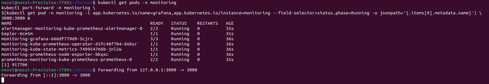
</div>


Make sure the forwarded port is allowed through your firewall and accessible from your workstation.

Grafana is available at:

http://localhost:3000

Use the following default credentials:

```bash
Username: admin
Password: admin
````

## UPF-VPP traffic per slice

cAdvisor refreshes the network counters of a pod only every 10-30 s, which is too coarse to see a flow cross the UPF-VPP. The DaemonSet [`monitoring/upf-vpp-exporter.yaml`](monitoring/upf-vpp-exporter.yaml) exports the byte counters of the N3, N4 and N6 interfaces of every UPF-VPP pod, labelled by slice (`upf="VPP-UPF-SLICE<N>"`), and Prometheus scrapes it every 2 s:

```bash
kubectl apply -f monitoring/upf-vpp-exporter.yaml
```

Downlink of a slice: `rate(upf_vpp_interface_transmit_bytes_total{interface="n3-2"}[10s])*8/1e6` (Mbit/s); uplink: the same with `upf_vpp_interface_receive_bytes_total`. Plot them in Grafana with one series per `upf` label, next to the AMBR of each slice, to compare a slice with its QoS profile.

## Dashboards

In Grafana, go to **Dashboards** to access the available cluster, node, and pod monitoring dashboards.

When using a dashboard, make sure to select the correct namespace.
For the OAI deployment, use **`oai5g`** instead of `default`.

Then select the pod whose resources you want to monitor.

<div align="center">
    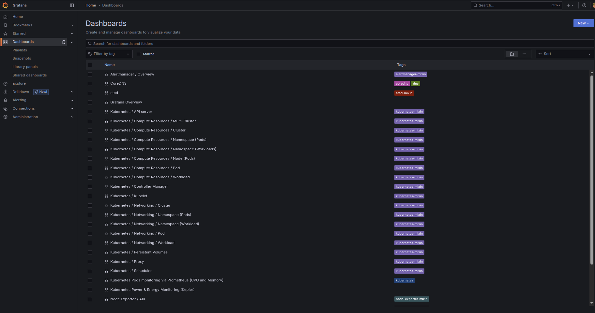
</div>

### Example

<div align="center">
    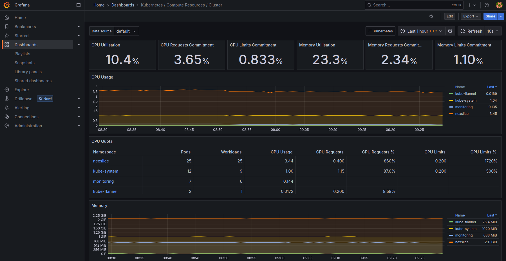
</div>

## Kepler

The **Kepler dashboard** provides power and energy monitoring for the Kubernetes cluster.

It includes:

* total cluster power in **watts**
* power over time
* power usage by namespace
* energy consumption by namespace in **joules**
* power and energy usage by pod
* power and energy usage by container

Use the **Pod** filter at the top of the dashboard to focus on a specific workload.

<div align="center">
    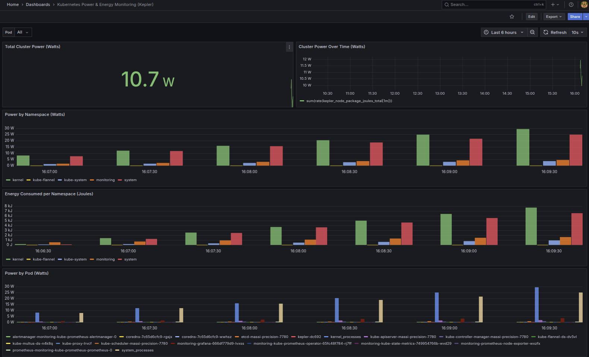
</div>
```


# License and citation

## License

Elastic5G builds on [OpenAirInterface (OAI)](https://openairinterface.org/) software (OAI 5G Core, OAI RAN and OAI NWDAF components). The OAI code is distributed under the **OAI Collaborative Standards Software License v1.0 (CSSL v1.0)**, available at:

**<https://openairinterface.org/oai-cssl/>**

Some files of this repository still carry the previous *OAI Public License v1.1* header, which now points to the same page. **Anyone who uses, modifies or redistributes this repository must respect the OAI license terms.** The other components used here (UERANSIM, VPP, MySQL, MongoDB, Kong, Prometheus, Grafana, Kepler, ...) keep their own licenses.

## Citation

If you use Elastic5G in your work, we would be grateful if you cite our paper, accepted at **CNSM 2026**:

> M. Ait Aba, A. Y. Brahmi, N.-E.-H. Yellas and B. Jouaber, "Elastic5G: A Rebuildable Kubernetes Testbed for Dynamic Network Slicing and NWDAF-Enabled Analytics for 5G Core Research," in *Proc. 22nd International Conference on Network and Service Management (CNSM)*, Alcalá de Henares, Spain, Oct. 26-30, 2026. Code: <https://github.com/AITABAmassinissa/Elastic5G>

```bibtex
@inproceedings{aitaba2026elastic5g,
  author    = {Ait Aba, Massinissa and Brahmi, Abdenour Yasser and Yellas, Nour-El-Houda and Jouaber, Badii},
  title     = {{Elastic5G}: A Rebuildable {Kubernetes} Testbed for Dynamic Network Slicing and {NWDAF}-Enabled Analytics for {5G} Core Research},
  booktitle = {Proc. 22nd International Conference on Network and Service Management (CNSM)},
  address   = {Alcal{\'a} de Henares, Spain},
  month     = oct,
  year      = {2026},
  note      = {Code: \url{https://github.com/AITABAmassinissa/Elastic5G}}
}
```

GitHub also offers a *Cite this repository* button, generated from [`CITATION.cff`](CITATION.cff).
