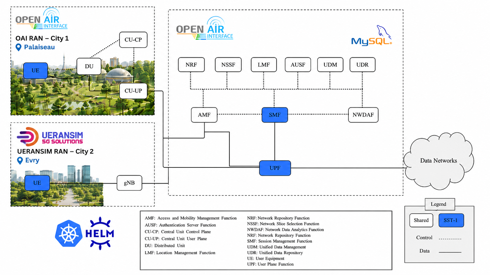
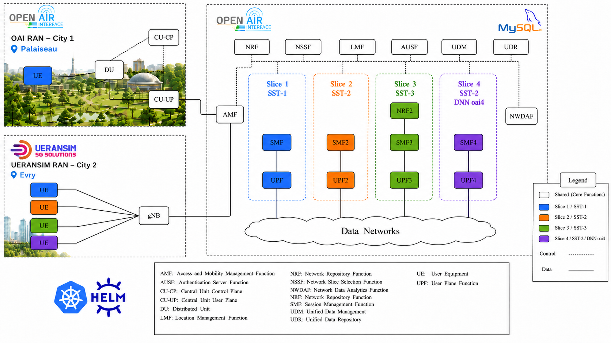

## UERANSIM Deployment

In this section, we add a second RAN to the existing 5G core network using **UERANSIM**.

**UERANSIM** is an open-source 5G simulator that emulates both **gNB** and **UE** functionalities. It provides a lightweight and practical solution for testing UE registration, PDU session establishment, slice attachment, and user-plane connectivity.

In this part, UERANSIM is used to validate the slicing configuration step by step. We first deploy a UERANSIM gNB, then attach UEs to different slices and compare their throughput using `iperf3`.

NWDAF can also be used as an additional validation layer to check whether the UEs are visible from the core network monitoring point of view. The detailed NWDAF validation commands are provided in [NWDAF slicing validation](NWDAF-slicing-validation.md).

As with the OAI disaggregated setup, deploy the components **one at a time**, waiting a few seconds between each step.


### Deploy the UERANSIM gNB

```bash
helm install ueransim-gnb oai-5g-ran/ueransim-gnb3/ -n oai5g
````

<div align="center">
    
</div>

---

## Deploy iperf3 Server

To validate the QoS behavior of each slice, we use `iperf3`.

The `ping` command is useful to check basic connectivity, but it only sends small ICMP packets. It does not generate enough traffic to evaluate bandwidth limits such as `session_ambr_ul` and `session_ambr_dl`.

For this reason, an `iperf3` server is deployed inside the Kubernetes cluster. Each UE will then run an `iperf3` client through its own tunnel interface.

```bash
kubectl run iperf-server -n oai5g \
  --image=networkstatic/iperf3 \
  --restart=Never \
  -- iperf3 -s
```


---

## Slice 1: Default Slice

The default slice is already part of the deployed 5G core. Its SMF configuration is located in:

```text
oai-5g-core/oai-smf/config.yaml
````

The following block defines the local subscription information for `slice1`:

```yaml
smf:
  support_features:
    use_local_subscription_info: yes # Use local_subscription_infos instead of UDM/MySQL subscription data

  local_subscription_infos:
    - single_nssai: *slice1
      dnn: "oai"
      qos_profile:
        5qi: 9                     # 5QI value, allowed range: 1-254
        priority: 50               # QoS priority level, allowed range: 1-127; lower value means higher priority
        arp_priority: 10           # ARP priority level, allowed range: 1-15; lower value means higher priority
        session_ambr_ul: "100Mbps" # Session AMBR uplink
        session_ambr_dl: "100Mbps" # Session AMBR downlink
```

The parameter `use_local_subscription_info` must be set to `yes` if we want the SMF to apply the QoS values defined in `local_subscription_infos`.

If `use_local_subscription_info` is set to `no`, the SMF will use the subscriber information coming from UDM/MySQL instead. In that case, the QoS and AMBR values are taken from the subscriber database file:

```text
oai-5g-core/mysql/initialization/oai_db-basic.sql
```

For example, the database may contain the following subscription entry for UE `001010000000100`:

```sql
('001010000000100', '00101', '{"sst": 1, "sd": "FFFFFF"}',
'{"oai":{"pduSessionTypes":{"defaultSessionType":"IPV4"},"sscModes":{"defaultSscMode":"SSC_MODE_1"},"5gQosProfile":{"5qi":1,"arp":{"priorityLevel":15,"preemptCap":"NOT_PREEMPT","preemptVuln":"PREEMPTABLE"},"priorityLevel":15},"sessionAmbr":{"uplink":"1000Mbps","downlink":"1000Mbps"},"staticIpAddress":[{"ipv4Addr":"12.1.1.100"}]}}')
```

In this example, the database defines `sessionAmbr` values of `1000Mbps` for both uplink and downlink. Therefore, if `use_local_subscription_info` is set to `no`, the expected throughput may no longer be limited to the `100Mbps` value configured in the SMF local subscription block.

This configuration associates the default slice with the DNN `oai`. The QoS profile defines the default 5QI, priority values, and the maximum allowed uplink and downlink bitrates for the PDU session. Here, with `use_local_subscription_info: yes`, the expected throughput is limited to approximately **100 Mbps**.


### Deploy the UE attached to slice 1

```bash
helm install ueransim-ue3 oai-5g-ran/ueransim-ue3/ -n oai5g
```

### Test connectivity with ping

```bash
kubectl exec -it -n oai5g \
$(kubectl get pod -n oai5g \
-l app.kubernetes.io/name=ueransim-ue3,app.kubernetes.io/instance=ueransim-ue3,app.kubernetes.io/component=ues \
--field-selector=status.phase=Running \
-o jsonpath='{.items[0].metadata.name}') \
-- ping -c 3 -I uesimtun0 google.com
```

### Test throughput with iperf3

```bash
kubectl exec -it -n oai5g \
$(kubectl get pod -n oai5g \
-l app.kubernetes.io/name=ueransim-ue3,app.kubernetes.io/instance=ueransim-ue3,app.kubernetes.io/component=ues \
--field-selector=status.phase=Running \
-o jsonpath='{.items[0].metadata.name}') \
-- sh -c 'UE_IP=$(ip -o -4 addr show dev uesimtun0 | awk "{print \$4}" | cut -d/ -f1); echo "Using UE tunnel IP: $UE_IP"; iperf3 -c "$1" -B "$UE_IP" -t 20' sh \
$(kubectl get pod iperf-server -n oai5g -o jsonpath='{.status.podIP}')
```

### Result

```text
[  5]   0.00-20.00  sec   242 MBytes   101 Mbits/sec  22206             sender
[  5]   0.00-20.00  sec   239 MBytes   100 Mbits/sec                  receiver
```

The measured throughput is approximately **100 Mbps**, which matches the configured `session_ambr_ul` and `session_ambr_dl` values for slice 1. This confirms that the default slice is correctly configured and that the AMBR limitation is applied.

---

## Slice 2: Additional Slice with 200 Mbps AMBR

In this step, we add a second slice to the existing core network.

This slice is deployed using two additional network functions:

* `SMF2`: manages the PDU sessions for slice 2;
* `UPF2`: forwards the user-plane traffic for slice 2.

A separate SMF and UPF are used so that slice 2 can have its own DNN, subnet, and QoS profile. This allows the slice to be configured independently from the default slice.

The SMF2 configuration is located in:

```text
slice2/oai-smf2/config.yaml
```

```yaml
local_subscription_infos:
  - single_nssai: *slice2
    dnn: "oai2"
    qos_profile:
      5qi: 9                     # 5QI value, allowed range: 1-254
      priority: 50               # QoS priority level, allowed range: 1-127; lower value means higher priority
      arp_priority: 10           # ARP priority level, allowed range: 1-15; lower value means higher priority
      session_ambr_ul: "200Mbps" # Session AMBR uplink
      session_ambr_dl: "200Mbps" # Session AMBR downlink
```

This configuration associates slice 2 with the DNN `oai2`. The expected throughput is approximately **200 Mbps**.

### Deploy slice 2

```bash
helm install upf2 slice2/oai-upf2 -n oai5g
helm install smf2 slice2/oai-smf2 -n oai5g
```


### Deploy the UE attached to slice 2

```bash
helm install ueransim-ue4 oai-5g-ran/ueransim-ue4/ -n oai5g
```

### Test connectivity with ping

```bash
kubectl exec -it -n oai5g \
$(kubectl get pod -n oai5g \
-l app.kubernetes.io/name=ueransim-ue4,app.kubernetes.io/instance=ueransim-ue4,app.kubernetes.io/component=ues \
--field-selector=status.phase=Running \
-o jsonpath='{.items[0].metadata.name}') \
-- ping -c 3 -I uesimtun0 google.com
```

### Test throughput with iperf3

```bash
kubectl exec -it -n oai5g \
$(kubectl get pod -n oai5g \
-l app.kubernetes.io/name=ueransim-ue4,app.kubernetes.io/instance=ueransim-ue4,app.kubernetes.io/component=ues \
--field-selector=status.phase=Running \
-o jsonpath='{.items[0].metadata.name}') \
-- sh -c 'UE_IP=$(ip -o -4 addr show dev uesimtun0 | awk "{print \$4}" | cut -d/ -f1); echo "Using UE tunnel IP: $UE_IP"; iperf3 -c "$1" -B "$UE_IP" -t 20' sh \
$(kubectl get pod iperf-server -n oai5g -o jsonpath='{.status.podIP}')
```

### Result

```text
[  5]   0.00-20.00  sec   484 MBytes   203 Mbits/sec  40441             sender
[  5]   0.00-20.00  sec   481 MBytes   202 Mbits/sec                  receiver
```

The measured throughput is approximately **202 Mbps**, which is consistent with the configured AMBR value of **200 Mbps**. This confirms that slice 2 is correctly attached to the core and that its QoS configuration is applied.

---

## Slice 3: Additional Slice with 500 Mbps AMBR

In this step, we add another slice with a higher AMBR value.

Unlike slice 2, this slice is deployed with three pods:

* `NRF2`: a dedicated NRF instance for this slice setup;
* `SMF3`: manages the PDU sessions for slice 3;
* `UPF3`: forwards the user-plane traffic for slice 3.

The main reason for adding a dedicated SMF and UPF is to isolate the control and user-plane management of this slice. The additional NRF instance is used here to test a more isolated deployment model, where the slice can rely on its own service discovery component.

The SMF3 configuration is located in:

```text
slice3/oai-smf3/config.yaml
```

```yaml
local_subscription_infos:
  - single_nssai: *slice3
    dnn: "oai3"
    qos_profile:
      5qi: 9                     # 5QI value, allowed range: 1-254
      priority: 50               # QoS priority level, allowed range: 1-127; lower value means higher priority
      arp_priority: 10           # ARP priority level, allowed range: 1-15; lower value means higher priority
      session_ambr_ul: "500Mbps" # Session AMBR uplink
      session_ambr_dl: "500Mbps" # Session AMBR downlink
```

This configuration associates slice 3 with the DNN `oai3`. The expected throughput is approximately **500 Mbps**.

### Deploy slice 3

```bash
helm install nrf2 slice3/oai-nrf2 -n oai5g
helm install upf3 slice3/oai-upf3 -n oai5g
helm install smf3 slice3/oai-smf3 -n oai5g
```

### Deploy the UE attached to slice 3

```bash
helm install ueransim-ue5 oai-5g-ran/ueransim-ue5/ -n oai5g
```


### Test connectivity with ping

```bash
kubectl exec -it -n oai5g \
$(kubectl get pod -n oai5g \
-l app.kubernetes.io/name=ueransim-ue5,app.kubernetes.io/instance=ueransim-ue5,app.kubernetes.io/component=ues \
--field-selector=status.phase=Running \
-o jsonpath='{.items[0].metadata.name}') \
-- ping -c 3 -I uesimtun0 google.com
```

### Test throughput with iperf3

```bash
kubectl exec -it -n oai5g \
$(kubectl get pod -n oai5g \
-l app.kubernetes.io/name=ueransim-ue5,app.kubernetes.io/instance=ueransim-ue5,app.kubernetes.io/component=ues \
--field-selector=status.phase=Running \
-o jsonpath='{.items[0].metadata.name}') \
-- sh -c 'UE_IP=$(ip -o -4 addr show dev uesimtun0 | awk "{print \$4}" | cut -d/ -f1); echo "Using UE tunnel IP: $UE_IP"; iperf3 -c "$1" -B "$UE_IP" -t 20' sh \
$(kubectl get pod iperf-server -n oai5g -o jsonpath='{.status.podIP}')
```

### Result

```text
[  5]   0.00-20.00  sec  1.17 GBytes   502 Mbits/sec  65553             sender
[  5]   0.00-20.00  sec  1.17 GBytes   501 Mbits/sec                  receiver
```

The measured throughput is approximately **501 Mbps**, which matches the configured AMBR value of **500 Mbps**. This confirms that slice 3 is correctly deployed and that the UE attached to this slice uses the expected QoS profile.

---

## Slice 4: Additional Slice with 500 Mbps AMBR

In this final step, we deploy another slice using different slice identifiers and a dedicated DNN.

This slice is used to validate that multiple slices can coexist with similar QoS parameters while remaining logically separated. Slice 4 uses its own SMF and UPF, its own DNN `oai4`, and its own UE.

The SMF4 configuration is located in:

```text
slice4/oai-smf4/config.yaml
```

```yaml
local_subscription_infos:
  - single_nssai: *slice4
    dnn: "oai4"
    qos_profile:
      5qi: 9                     # 5QI value, allowed range: 1-254
      priority: 50               # QoS priority level, allowed range: 1-127; lower value means higher priority
      arp_priority: 10           # ARP priority level, allowed range: 1-15; lower value means higher priority
      session_ambr_ul: "500Mbps" # Session AMBR uplink
      session_ambr_dl: "500Mbps" # Session AMBR downlink
```

This configuration associates slice 4 with the DNN `oai4`. The expected throughput is approximately **500 Mbps**.

### Deploy slice 4

```bash
helm install upf4 slice4/oai-upf4 -n oai5g
helm install smf4 slice4/oai-smf4 -n oai5g
```
<div align="center">
    
</div>

### Deploy the UE attached to slice 4

```bash
helm install ueransim-ue6 oai-5g-ran/ueransim-ue6/ -n oai5g
```

### Test connectivity with ping

```bash
kubectl exec -it -n oai5g \
$(kubectl get pod -n oai5g \
-l app.kubernetes.io/name=ueransim-ue6,app.kubernetes.io/instance=ueransim-ue6,app.kubernetes.io/component=ues \
--field-selector=status.phase=Running \
-o jsonpath='{.items[0].metadata.name}') \
-- ping -c 3 -I uesimtun0 google.com
```

### Test throughput with iperf3

```bash
kubectl exec -it -n oai5g \
$(kubectl get pod -n oai5g \
-l app.kubernetes.io/name=ueransim-ue6,app.kubernetes.io/instance=ueransim-ue6,app.kubernetes.io/component=ues \
--field-selector=status.phase=Running \
-o jsonpath='{.items[0].metadata.name}') \
-- sh -c 'UE_IP=$(ip -o -4 addr show dev uesimtun0 | awk "{print \$4}" | cut -d/ -f1); echo "Using UE tunnel IP: $UE_IP"; iperf3 -c "$1" -B "$UE_IP" -t 20' sh \
$(kubectl get pod iperf-server -n oai5g -o jsonpath='{.status.podIP}')
```

### Result

```text
[  5]   0.00-20.00  sec  1.17 GBytes   501 Mbits/sec  70390             sender
[  5]   0.00-20.00  sec  1.16 GBytes   500 Mbits/sec                  receiver
```

The measured throughput is approximately **500 Mbps**, which matches the configured AMBR value. This confirms that slice 4 is correctly deployed and that it behaves consistently with slice 3, since both slices use the same AMBR values.

---

## Summary of Results

| Slice   | UE  | DNN    | Tunnel IP  | Configured AMBR | Measured Throughput |
| ------- | --- | ------ | ---------- | --------------- | ------------------- |
| Slice 1 | UE3 | `oai`  | `12.1.1.2` | 100 Mbps        | ~100 Mbps           |
| Slice 2 | UE4 | `oai2` | `12.1.2.2` | 200 Mbps        | ~202 Mbps           |
| Slice 3 | UE5 | `oai3` | `12.1.3.2` | 500 Mbps        | ~501 Mbps           |
| Slice 4 | UE6 | `oai4` | `12.1.4.2` | 500 Mbps        | ~500 Mbps           |

The results show that the configured AMBR values are reflected in the measured throughput. The default slice reaches approximately **100 Mbps**, slice 2 reaches approximately **200 Mbps**, and slices 3 and 4 reach approximately **500 Mbps**.

This demonstrates that the deployed slicing architecture can provide different throughput levels by assigning different QoS profiles to each slice.

Changing SST from 1 to 2 does not automatically improve QoS by itself. The improvement comes from the slice configuration associated with that SST, such as higher AMBR, different 5QI, lower priority value, dedicated SMF/UPF, or a different UPF placement.

## Delete a slice

A slice can be removed by uninstalling the Helm releases associated with it.

In this example, we delete **slice 2**, which is composed of:

```text
UE4  -> ueransim-ue4
SMF2 -> smf2
UPF2 -> upf2
````

It is recommended to remove the UE first, because it depends on the slice-specific PDU session. Then remove the SMF and UPF.

```bash
helm uninstall ueransim-ue4 -n oai5g
helm uninstall smf2 -n oai5g
helm uninstall upf2 -n oai5g
```


## Subscriber database configuration

Before deploying the UEs, make sure that each UE is already declared in the OAI subscriber database file:

```text
oai-5g-core/mysql/initialization/oai_db-basic.sql
````

This file contains the subscriber information used by the core network during UE authentication and PDU session establishment.
For each UE, two parts must be configured:

1. **Authentication information**, in the `AuthenticationSubscription` table.
2. **Session management information**, in the `SessionManagementSubscriptionData` table.

For example, the UEs are organized by slice as follows:

```text
Slice 1: SST 1 / DNN oai  / UEs 001010000000100-120
Slice 2: SST 2 / DNN oai2 / UEs 001010000000200-220
Slice 3: SST 3 / DNN oai3 / UEs 001010000000300-320
Slice 4: SST 2 / DNN oai4 / UEs 001010000000400-420
```

Each UE used in the Helm charts must match one entry in this SQL file.
For example:

```text
ueransim-ue3 -> IMSI 001010000000100 -> SST 1 -> DNN oai
ueransim-ue4 -> IMSI 001010000000200 -> SST 2 -> DNN oai2
ueransim-ue5 -> IMSI 001010000000300 -> SST 3 -> DNN oai3
ueransim-ue6 -> IMSI 001010000000400 -> SST 2 -> DNN oai4
```

The S-NSSAI, DNN, authentication key, OPC, and static IP subnet must be consistent with the UE Helm values, the SMF configuration, and the UPF configuration.

For each slice, make sure that:

```text
UE IMSI exists in AuthenticationSubscription
UE IMSI exists in SessionManagementSubscriptionData
DNN matches the UE APN configuration
SST and SD match the AMF, NSSF, SMF, UPF and UE configuration
Static IP belongs to the subnet configured in the SMF and UPF
```

For example, if `ueransim-ue5` uses:

```yaml
sst: 3
apn: oai3
initialMSISDN: '0000000300'
```

then the database must contain:

```text
IMSI/SUPI: 001010000000300
SST: 3
DNN: oai3
```

If the UE is not declared correctly in `oai_db-basic.sql`, the UE may register incorrectly, fail authentication, or fail to create the PDU session. In that case, the tunnel interface `uesimtun0` will not be created.


In addition, the number of UEs provisioned for each slice can also be considered as a QoS-related design criterion.

In this setup, the number of supported UEs per slice is defined directly in the subscriber database file:

```text
oai-5g-core/mysql/initialization/oai_db-basic.sql
````

For example, each slice is associated with a specific IMSI range:

```text
Slice 1: UEs 001010000000100-120
Slice 2: UEs 001010000000200-220
Slice 3: UEs 001010000000300-320
Slice 4: UEs 001010000000400-420
```

This means that the maximum number of UEs allowed to attach to a given slice depends on how many subscribers are created for that slice in the SQL initialization file. By assigning a larger or smaller IMSI range to a slice, we can control how many UEs are allowed to use that slice.

Therefore, besides parameters such as `5qi`, `priority`, `arp_priority`, and `session_ambr`, the number of provisioned UEs per slice can be used as an additional slicing criterion. A slice dedicated to critical services may be configured with fewer authorized UEs, while a best-effort slice may support a larger number of subscribers.