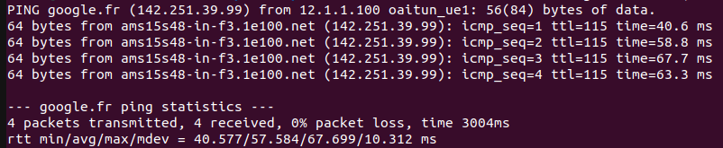
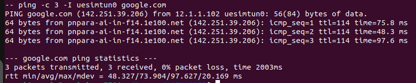

# Alternative Radio Access Network Deployments

This document contains additional RAN deployment options that can be used with the same 5G Core environment:

- a **monolithic OpenAirInterface (OAI) RAN**,
- and a **simulated UERANSIM RAN**.

These alternatives are useful for testing different 5G access architectures.

## OAI Monolithic 5G RAN

The monolithic OAI RAN combines the gNB functions in a single deployment. In this setup, one OAI gNB and one OAI NR-UE are deployed.

### Deploy the gNB

```bash
helm install gnb oai-5g-ran/oai-gnb1 --namespace oai5g
````

### Deploy the NR-UE

```bash
helm install nrue oai-5g-ran/oai-nr-ue1/ --namespace oai5g
```

### Test connectivity

To confirm that the UE has established a data session and can reach the Internet:

```bash
kubectl exec -it -n oai5g -c nr-ue $(kubectl get pods -n oai5g | grep oai-nr-ue1 | awk '{print $1}') -- ping -I oaitun_ue1 -c4 google.fr
```

<div align="center">
    
</div>

## UERANSIM Deployment

**UERANSIM** is an open-source 5G simulator that emulates both **gNB** and **UE** functionalities. It provides a lightweight and practical solution for testing registration, PDU session establishment, and basic user-plane connectivity.

As with the OAI disaggregated setup, deploy the components **one at a time**, waiting a few seconds between each step.

### Deploy the UERANSIM gNB

```bash
helm install ueransim-gnb oai-5g-ran/ueransim-gnb3/ -n oai5g
```

### Deploy the UERANSIM UE

```bash
helm install ueransim-ue3 oai-5g-ran/ueransim-ue3/ -n oai5g
```

### Test connectivity

To validate the data session from the UERANSIM UE:

```bash
kubectl exec -it -n oai5g \
$(kubectl get pod -n oai5g \
-l app.kubernetes.io/name=ueransim-ue3,app.kubernetes.io/instance=ueransim-ue3,app.kubernetes.io/component=ues \
--field-selector=status.phase=Running \
-o jsonpath='{.items[0].metadata.name}') \
-- ping -c 3 -I uesimtun0 google.com
```

<div align="center">
    
</div>
```